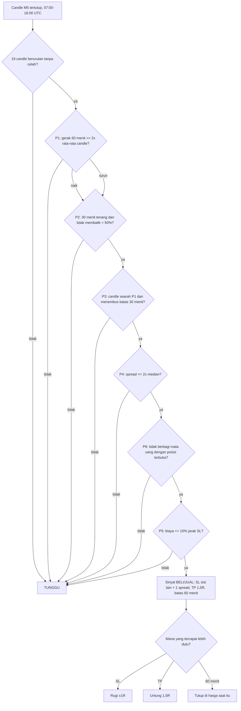

# Lolosyiob — Metode Analisa "Kerja Cepat" (15 Okt 2026)

**Status:** uji putaran 2 (bahan 2, 1 tahun, 778 trade) **TIDAK BERHASIL — metode Kerja Cepat v1 tidak punya keunggulan** (bagian 12). Putaran 1 juga gagal karena kekurangan kejadian. Tim, SOP dan workflow **belum ditetapkan**, sesuai perintah Fahmi: ditetapkan setelah uji berhasil.
**Bagian dari:** `docs/RANCANGAN-2026-10-15-scalping-finex-forex.md` (metode scalping Finex Forex).
**Skrip uji:** `scripts/research/kerja_cepat_bt.py`.

## 1. Nama

| Nama | Arti |
| --- | --- |
| **Lolosyiob** | Metode scalping MDBKA di Finex Forex |
| **Kerja Cepat** | Metode analisa di dalam Lolosyiob: aturan masuk, keluar dan penyaring |

## 2. Cerita pencari fakta (dasar logika)

Sebuah tim pencari fakta menyelidiki kematian rekan kerja mereka, si A. A meninggal di depan mereka saat suasana sangat bahagia, jadi tidak ada petunjuk yang jelas. Yang mereka punya hanya tiga petunjuk:

| Petunjuk | Dalam cerita | Dalam harga (Kerja Cepat) |
| --- | --- | --- |
| P1 | 1 jam sebelumnya A **naik atau turun** ke parkiran | Arah harga **60 menit** (12 candle M5). Gerak harus jelas: ≥ 2× rata-rata panjang candle M5 jam itu. Naik → calon BELI, turun → calon JUAL. Bila A tidak ke mana-mana (gerak kecil), kasus ditutup: tidak ada sinyal |
| P2 | Lalu **ngobrol 30 menit** dalam suasana bahagia, tanpa tanda bahaya | **30 menit tenang** (6 candle M5): rentangnya ≤ 2× rata-rata candle jam itu, dan harga tidak kembali lebih dari setengah gerak P1 |
| P3 | A **menyentuh gelas merah/hijau**, lalu meninggal | **Candle pemicu**: warnanya searah P1 (hijau untuk naik, merah untuk turun) **dan** close-nya menembus batas 30 menit itu |

Sebelum menyimpulkan, tim memeriksa saksi lain:
- **P4 spread:** saat masuk, spread tidak boleh lebih dari 2× biasanya.
- **P5 biaya:** biaya pulang-pergi tidak boleh lebih dari 10% jarak SL. Ini gerbang biaya MDBKA, tidak dilonggarkan.
- **P6 korelasi:** satu kejadian tidak boleh dituduhkan ke dua tersangka. Sinyal ditolak bila pasangannya berbagi mata uang dengan posisi yang masih terbuka.

**Kesimpulan diuji dengan:**
- **SL** di sisi lain obrolan 30 menit + 1 spread. Bila harga kembali ke sana, teorinya salah.
- **TP** di 1,5R.
- **Batas waktu 60 menit.** Bila belum terbukti dalam satu jam, kasus ditutup apa adanya.

## 3. Bahan mentah

| No | Bahan | Sumber | Yang diturunkan darinya |
| --- | --- | --- | --- |
| 1 | **Kuotasi bid/ask Finex berstempel waktu** (±2 detik) | Arsip MDBKA `data/history/finex/ticks-*.jsonl` (T-DATA) | Candle M1/M5, spread, jam sesi |
| 2 (usulan, setelah uji 1 gagal) | **Riwayat candle M5 server Finex** (±1 tahun, dengan kolom spread) | Skrip MT5 `ExportLongH1MDBKA.mq5` diberi pilihan M5 (**perlu izin**) | Kejadian cukup banyak untuk dinilai |

Hanya satu bahan yang dipakai di uji 1. Komisi $1/lot adalah fakta tetap Finex, bukan bahan.

## 4. Flowchart Kerja Cepat



**Parameter dibekukan sebelum uji** (tidak disetel ulang setelah melihat hasil):
- **Pasangan:** USDJPY, EURJPY, GBPUSD, GBPJPY, EURUSD. Dipilih dari biaya ÷ range M5 ≤ 0,30, bukan dari hasil uji.
- **Sesi:** 07:00–16:00 UTC (16:00–01:00 WIT).
- **Masuk dan keluar** memakai bid/ask nyata. Bila SL dan TP tersentuh di menit yang sama, dianggap kena SL (anggapan konservatif).

## 5. Kriteria berhasil (ditulis sebelum uji)

| Kode | Syarat |
| --- | --- |
| K1 | Jumlah trade ≥ 20 (aturan MDBKA n ≥ 20) |
| K2 | Rata-rata R bersih (setelah spread + komisi) > 0 |
| K3 | Profit factor ≥ 1,2 |
| K4 | ≥ 5 dari 7 hari uji ber-R positif (hari tanpa trade = tidak berhasil) |
| K5 | Rugi terburuk ≥ −1,1R (sejalan K-10) |
| K6 | Total R tanpa hari terbaik tetap > 0 (tidak bergantung satu hari) |

## 6. Hasil uji putaran 1 (bahan 1 saja)

### 6.1 Uji logika flowchart: 7 skenario buatan — 7/7 benar

| No | Skenario | Harapan | Hasil |
| --- | --- | --- | --- |
| 1 | Naik jelas, 30 menit tenang, gelas hijau menembus | BELI | BELI ✔ |
| 2 | Cermin skenario 1 (turun) | JUAL | JUAL ✔ |
| 3 | Jam tanpa arah | TUNGGU (P1) | TUNGGU ✔ |
| 4 | Obrolan tidak tenang | TUNGGU (P2) | TUNGGU ✔ |
| 5 | Gelas merah padahal jam naik | TUNGGU (P3) | TUNGGU ✔ |
| 6 | Gelas hijau tapi tidak menembus | TUNGGU (P3) | TUNGGU ✔ |
| 7 | Obrolan tenang tetapi membalik > 50% | TUNGGU (P2) | TUNGGU ✔ |

Artinya cabang-cabang flowchart bekerja sesuai rancangan.

### 6.2 Uji data nyata Finex: 7 hari

Tabel di bawah memakai 7 hari data tick Finex, 6–14 Okt 2026. Rupiah dihitung untuk lot 0,01 dengan kurs Rp17.880.

| Uji | Hari | Trade | Menang | R bersih | Rupiah | Hasil |
| --- | --- | --- | --- | --- | --- | --- |
| 1 | Sel 6 Okt | 3 | 2 | +1,64 | +Rp30.183 | Berhasil |
| 2 | Rab 7 Okt | 1 | 0 | −1,01 | −Rp23.933 | Tidak |
| 3 | Kam 8 Okt | 0 | — | 0 | Rp0 | Tidak (data bolong 12–20 UTC) |
| 4 | Jum 9 Okt | 1 | 0 | −0,04 | −Rp969 | Tidak |
| 5 | Sen 12 Okt | 1 | 1 | +0,09 | +Rp1.430 | Berhasil |
| 6 | Sel 13 Okt | 1 | 1 | +0,15 | +Rp1.853 | Berhasil |
| 7 | Rab 14 Okt | 0 | — | 0 | Rp0 | Tidak (arsip berhenti 11:58 UTC) |
| **Jumlah** | | **7** | **4 (57%)** | **+0,83** | **+Rp8.565** | |

| Kriteria | Nilai | Lolos? |
| --- | --- | --- |
| K1 n ≥ 20 | 7 | **Tidak** |
| K2 rata-rata > 0 | +0,118R | Ya |
| K3 PF ≥ 1,2 | 1,69 | Ya |
| K4 ≥ 5/7 hari | 3/7 | **Tidak** |
| K5 terburuk ≥ −1,1R | −1,01R | Ya |
| K6 tanpa hari terbaik > 0 | −0,81R | **Tidak** |

**Vonis: TIDAK BERHASIL.** Hasilnya positif, tetapi 7 trade tidak cukup untuk menjadi bukti.

**Rincian:**
- SL median 15,7 pip; biaya median 1,06 pip (7% dari SL, lolos gerbang 10%); risiko median Rp23.754 per trade (lot 0,01).
- Cara keluar: 5× batas waktu, 1× TP, 1× SL. Lama rata-rata 52 menit.
- Penyaringan dari ±1.500 candle yang dinilai:
  - P1 menolak 918 (tidak ada arah jam);
  - P2 menolak 449 (tidak tenang atau membalik);
  - P3 menolak 132;
  - P4, P5 dan P6 menolak 11;
  - 3 tidak bisa dinilai karena data habis.

### 6.3 Sebab gagal (analisa akar masalah)

1. **Sebab utama: kejadian terlalu sedikit.** Rata-rata hanya ±1 trade per hari di 5 pasangan. Untuk n ≥ 20 dibutuhkan ±20 hari data tanpa celah.
2. **Bahan 1 bolong.** Arsip tick punya celah: 8 Okt 12–20 UTC, 14 Okt setelah 11:58 UTC, dan sebagian jam di hari lain. Dari 132 candle M5 per hari pada 05–16 UTC (sesi + pemanasan), hanya 84–120 yang ada. Dua hari uji (3 dan 7) gagal karena data, bukan karena metode.
3. **Bukan sebab utama, tetapi dicatat:** 5 dari 7 trade ditutup batas waktu 60 menit dengan R kecil. Batas 60 menit mungkin terlalu pendek untuk TP 1,5R dengan SL ±15 pip. **Parameter ini tidak diubah sekarang**, karena mengubahnya setelah melihat hasil sama dengan menyetel jawaban agar cocok dengan soal. Bila ingin dicoba, variasi itu harus diuji di data baru, bukan di 7 hari ini.

**Kesimpulan:** kegagalan ini **membutuhkan tambahan bahan**, yaitu data yang lebih panjang dan tanpa celah. Penyaring baru (misalnya berita) justru akan mengurangi n, jadi tidak menjawab sebab gagal.

## 7. Bahan tambahan (hanya 1) dan rencana uji ulang

**Bahan 2: riwayat candle M5 server Finex**, ±1 tahun, berisi OHLC, tick volume dan kolom spread dari MT5.

Cara mendapatkannya:
1. Perubahan kecil pada skrip `ea/ExportLongH1MDBKA.mq5`: pilihan `InpPeriod` ditambah M5 dan file keluaran `MDBKA_<simbol>_M5_LONG.csv`.
2. Fahmi menjalankannya **sekali** di terminal Finex, dengan isian ±75.000 candle (±1 tahun).
3. Skrip ini **tidak** mengubah service atau EA live.

**Perlu izin Fahmi**, karena menyentuh file MT5 (aturan "tidak mengubah EA tanpa izin"). Ini sama dengan keputusan SC-2.

**Uji ulang (putaran 2):**
- Parameter sama persis dengan bagian 4.
- Data dibagi menjadi **7 blok waktu berurutan**. Uji 1–7 = blok 1–7.
- Kriteria K1–K6 sama; "hari" pada K4 menjadi "blok".
- Masuk dan keluar memakai harga candle M5 plus spread dari kolom spread. Batasnya: urutan SL dan TP di dalam satu candle tidak diketahui, sehingga dianggap kena SL (konservatif).
- Bila berhasil, hasilnya dicocokkan dengan arsip tick bahan 1 di hari yang sama. Setelah itu baru tim, SOP dan workflow Lolosyiob ditetapkan.

### 7a. Saksi MACD (diminta Fahmi; dibekukan sebelum data M5 ada)

- **Pilihan:** MACD **12,26,9**, yaitu standar MT5 dan TA-Lib. "26" adalah EMA lambat. MACD 50 bukan pengaturan baku, jadi tidak dipakai.
- **Bukan bahan baru:** MACD dihitung dari candle M5 yang sama (bahan 2). Kolom `macd_main` dan `macd_signal` di file M5 berguna untuk mencocokkan hitungan T-IND dengan MT5. Catatan: garis sinyal MT5 = **SMA** dari main, sedangkan TA-Lib memakai EMA.
- **Varian B "Kerja Cepat + saksi MACD":** semua langkah P1–P6 sama, ditambah satu syarat di candle pemicu:
  - BELI hanya bila `macd_main > 0`;
  - JUAL hanya bila `macd_main < 0`.
- **Urutan penilaian:** vonis utama tetap varian A (tanpa MACD). Varian B dilaporkan berdampingan, dan baru boleh dipilih bila lolos K1–K6 **dan** tidak lebih buruk dari A di ≥ 4 dari 7 blok. Dua varian diuji sekaligus, jadi peluang "beruntung" naik. Hal ini dicatat di rapor.

## 8. Batas data

- Data tick bahan 1 hanya 7 hari uji, dengan celah, dan sampelnya ±2 detik (bukan setiap tick).
- 7 trade tidak bisa membuktikan apa pun, baik untung maupun rugi.
- Kurs Rp17.880 adalah kurs ECB yang dipakai tinjauan risiko 15 Okt 2026.

## 9. Sumber gagasan metode

- **Bob Volman, *Forex Price Action Scalping*:** penyempitan gerak (*build-up*) sebelum tembusan, dan masuk searah arah dominan. Ringkasan diskusi: [Elite Trader — Volman Price Action Method](https://elitetrader.com/et/threads/volman-price-action-method.385723/post-6160745).
- **Gao, Han, Li & Zhou, "Market Intraday Momentum":** gerak awal cenderung berlanjut di dalam hari yang sama. Penelitiannya di saham AS, bukan Forex, jadi hanya ilham. Ringkasan: [Alpha Architect](https://alphaarchitect.com/2014/08/attention-prop-traders-the-first-half-hour-of-trading-predicts-the-last-half-hour/).
- **Fakta biaya dan jam Finex:** `docs/HANDOFF-SCALPING-FINEX-FOREX.md` bagian 3.
- **Pelajaran AP-1 akun pembelajaran** (untung kecil, rugi besar): karena itu TP ditetapkan 1,5R, bukan < 1R.

## 10. Cara mengulang

```
python3 scripts/research/scalp_finex_agg.py data/history/finex/ticks-2026-10-XX.jsonl m1-XX.csv   (per hari, lalu gabung)
python3 scripts/research/kerja_cepat_bt.py gabungan-m1.csv
```

## 11. API MT5 untuk integrasi MDBKA (riset 15 Okt 2026)

| Jalur | Siapa yang boleh memakai | Cocok untuk MDBKA? |
| --- | --- | --- |
| API khusus Finex | Tidak ditemukan di sumber publik (finex.co.id, ulasan broker) | — |
| MT5 Manager API / Web API | **Broker**, untuk back-office | Tidak; bukan untuk nasabah |
| Paket Python resmi MetaQuotes `MetaTrader5` | Siapa saja; tersambung ke terminal MT5 yang **sedang berjalan di komputer yang sama** (Windows), dengan akun apa pun termasuk Finex | **Ya, untuk membaca data**: `copy_rates_range` (candle), `copy_ticks_range` (tick bid/ask asli dari server), `positions_get`, `history_deals_get` |

**Batas:**
- Paket ini juga punya `order_send` (kirim order). MDBKA **tidak boleh** memakainya; hanya fungsi baca yang dipakai.
- Seberapa jauh riwayat tick bisa ditarik tergantung server Finex. Harus dicoba dulu.
- Ini perubahan arsitektur dari "EA menulis CSV" menjadi "skrip Python membaca terminal". Perlu keputusan Fahmi (usulan **API-1**). Untuk sekarang, jalur skrip MQL5 di bagian 7 sudah cukup.

## 12. Hasil uji putaran 2 — bahan 2 (riwayat M5 server Finex)

**Data:**
- `MDBKA_<pasangan>_M5_LONG.csv`, 75.000 candle per pasangan, diekspor Fahmi 15 Okt 2026 pukul 13:27 WIT.
- Rentang uji: 28 Sep 2025 – 15 Okt 2026 (UTC).
- Skrip: `scripts/research/kerja_cepat_bt_m5.py`.
- Langkah P1–P6 sama persis dengan putaran 1. Penyesuaian hanya karena bentuk data:
  - candle MT5 = harga bid, dan ask = bid + kolom spread;
  - jam server = jam New York + 7 (buka mingguan selalu Senin 01:00 server);
  - jalur keluar dinilai per candle M5.

**Pemeriksaan mesin uji:**
- Di 6–14 Okt, 6 dari 7 trade putaran 1 (arsip tick) muncul lagi di **jam yang sama**, dengan SL dan R hampir sama. Contoh: GBPJPY 6 Okt 11:15 kena TP +1,49R di kedua data.
- Satu-satunya yang tidak muncul lagi adalah USDJPY 13 Okt 13:45.
- Riwayat M5 menemukan 15 trade di hari-hari itu (+3,08R), karena arsip tick bolong.
- Kesimpulan: konversi jam dan logika sama dengan putaran 1.

**Hasil (Rupiah untuk lot 0,01, kurs Rp17.880):**

| Uji | Blok | Trade | Menang | R bersih | Rupiah | Hasil |
| --- | --- | --- | --- | --- | --- | --- |
| 1 | 28 Sep – 21 Nov 2025 | 148 | 62 | −4,29 | −Rp152.042 | Tidak |
| 2 | 21 Nov 2025 – 15 Jan 2026 | 113 | 57 | +3,43 | +Rp135.717 | Berhasil |
| 3 | 15 Jan – 10 Mar 2026 | 119 | 48 | −9,90 | −Rp174.243 | Tidak |
| 4 | 10 Mar – 4 Mei 2026 | 105 | 41 | −19,08 | −Rp371.061 | Tidak |
| 5 | 4 Mei – 28 Jun 2026 | 95 | 43 | −7,34 | −Rp43.220 | Tidak |
| 6 | 28 Jun – 21 Agu 2026 | 104 | 43 | −15,89 | −Rp287.357 | Tidak |
| 7 | 21 Agu – 15 Okt 2026 | 94 | 34 | −13,60 | −Rp340.258 | Tidak |
| **Jumlah** | | **778** | **42%** | **−66,66** | **−Rp1.232.464** | |

| Kriteria | Varian A (utama) | Varian B (+ saksi MACD) |
| --- | --- | --- |
| K1 n ≥ 20 | 778 ✔ | 768 ✔ |
| K2 rata-rata > 0 | −0,086R ✘ | −0,085R ✘ |
| K3 PF ≥ 1,2 | 0,79 ✘ | 0,79 ✘ |
| K4 ≥ 5/7 blok | 1/7 ✘ | 1/7 ✘ |
| K5 terburuk ≥ −1,1R | −1,02R ✔ | −1,02R ✔ |
| K6 tanpa blok terbaik > 0 | −70,10R ✘ | −68,56R ✘ |
| **Vonis** | **TIDAK BERHASIL** | **TIDAK BERHASIL** |

### 12.1 Sebab gagal (analisa akar masalah)

1. **Bukan karena biaya.** Biaya rata-rata hanya 0,067R per trade, dan gerbang 10% bekerja. Tanpa biaya pun hasilnya −0,019R per trade. **Pemicu "tembus setelah tenang" pada M5 memang tidak punya keunggulan** di 5 pasangan ini selama setahun.
2. **Tembusan jarang berlanjut.**
   - Hanya 11% trade yang mencapai TP 1,5R (85 dari 778), sedangkan 29% kena SL.
   - Sebanyak 60% ditutup batas waktu 60 menit dengan gerak kecil.
   - Ini sejalan dengan peringatan Volman bahwa tembusan biasa sering gagal karena dilawan pemain kontra.
3. **Jam terburuk 07–09 UTC (16–18 WIT, pembukaan London):** −54,0R dari total −66,7R.
4. **Saksi MACD tidak menambah informasi.** Hanya 28 dari ±800 sinyal yang disaring. Setelah harga bergerak ≥ 2× panjang candle dalam satu jam, MACD hampir selalu sudah searah, karena MACD dihitung dari harga yang sama.
5. **Hasil putaran 1 (+0,83R) adalah kebetulan** dari 7 trade. Dengan data setahun, keunggulan itu hilang. Inilah alasan aturan n ≥ 20 dan uji di banyak blok.

### 12.2 Keputusan proses

- Bahan tambahan yang diizinkan (1 bahan) **sudah dipakai**. Kegagalan ini **bukan karena kekurangan bahan**, jadi menambah bahan lagi tidak menjawab sebabnya.
- **Kerja Cepat v1 dinyatakan TIDAK LAYAK.** Tim, SOP dan workflow Lolosyiob **tidak ditetapkan**.
- Parameter **tidak disetel ulang** di data yang sama. Itu sama dengan mencocokkan jawaban dengan soal.

**Pilihan lanjutan (keputusan Fahmi):**

| Kode | Pilihan | Catatan |
| --- | --- | --- |
| LY-1 | Hentikan Lolosyiob; scalping tetap riset | Paling aman |
| LY-2 | Rancang **Kerja Cepat v2** dengan bahan yang sama (bahan 1 + 2), memakai pembagian jujur: dirancang di 28 Sep 2025 – 30 Apr 2026, lalu diuji **satu kali** di 1 Mei – 15 Okt 2026 | Gagasan baru (misalnya hindari 07–09 UTC, atau batas waktu lebih panjang) hanya boleh dinilai di bagian ujian |
| LY-3 | Uji maju (*forward*) tanpa uang dari 16 Okt 2026, tanpa mengubah apa pun | Lambat; v1 sudah terbukti negatif setahun, jadi kecil gunanya |
