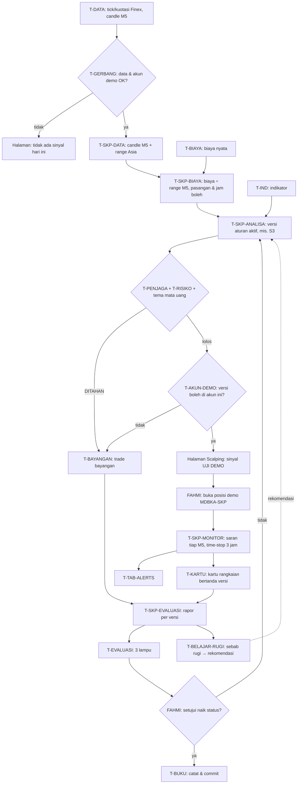

# Rancangan Metode Scalping Finex Forex — Halaman, Tim, SOP, Workflow (15 Okt 2026)

**Status:** RANCANGAN, menunggu persetujuan Fahmi. Belum ada kode yang berubah.
**Pembaruan 15 Okt 2026 (siang):** metode pertama ditetapkan bernama **Lolosyiob** dengan analisa **Kerja Cepat**. Uji putaran 1 tidak berhasil karena n = 7. Tim dan SOP di bawah masih rancangan dan baru ditetapkan setelah uji ulang berhasil.
**Dasar:** `docs/HANDOFF-SCALPING-FINEX-FOREX.md` (riset biaya & uji S1–S3), `docs/ANALISA-AKUN-PEMBELAJARAN-EXNESS-2026-10-15.md` (AP-4), `docs/SOP-2026-10-13-tim-mdbka.md` (tim, wewenang, format SOP), `docs/TINJAUAN-RISIKO-2026-10-15-toleransi-lampu2.md` (R-1/R-2).
**Setelah disetujui:** tabel tim dan SOP di bawah dipindah T-BUKU ke dokumen SOP induk (A1, A3, C, D) lewat SOP-12.

## 1. Tujuan dan prinsip

Scalping mendapat **halaman sendiri, tim sendiri, SOP sendiri dan workflow sendiri**, tetapi **tidak punya jalan pintas**. Semua data, penjaga, risiko dan lampu tetap memakai tim yang sudah ada.

| No | Prinsip | Alasan |
| --- | --- | --- |
| P-1 | Hanya **Finex** dan hanya **Forex** | Biaya Finex sudah diukur dari tick nyata (handoff bagian 3) |
| P-2 | **Gerbang biaya 10% tetap utuh**. Scalping = SL ≥ 10× biaya pulang-pergi (usulan SC-1) | Biaya justru penyebab S1/S2 rugi |
| P-3 | Semua sinyal scalping **wajib lewat T-PENJAGA** (Mode Aman) | Tidak ada penjaga khusus yang lebih longgar |
| P-4 | Risiko scalping **memakai batas golongan Forex yang sama** (Rp35.000 ÷ 1,1, maks 2 posisi per simbol), tidak ada anggaran tambahan | T-RISIKO harus melihat satu angka gabungan |
| P-5 | Status awal **UJI_DEMO**; naik hanya lewat 3 lampu + persetujuan Fahmi | Tangga bukti yang sama dengan metode lain |
| P-6 | **MDBKA tidak mengirim order.** Fahmi yang membuka posisi di MT5 | Aturan dasar MDBKA |
| P-7 | Hasil analisa Finex di halaman utama **tidak berubah** (aturan mutlak 1) | Scalping tampil di halaman sendiri |
| P-8 | Tidak ada angka karangan; data kosong = "belum ada data" | Aturan dasar MDBKA |

**Analogi:** tim scalping seperti **tim pencari fakta** yang menyelidiki kematian rekan kerja mereka, si A, dari petunjuk yang sangat sedikit. Tim ini bekerja sendiri dan cepat, tetapi berkas petunjuknya diambil dari arsip yang sama (T-DATA), kesimpulannya diperiksa pengawas yang sama (T-PENJAGA), dan anggarannya satu (T-RISIKO). Rincian cerita dan metodenya: `docs/LOLOSYIOB-KERJA-CEPAT-2026-10-15.md` (metode **Lolosyiob**, analisa **Kerja Cepat**).

## 2. Tim scalping (lapisan, tugas, wewenang)

Kode wewenang sama dengan SOP induk: B baca, C catat, H hitung, U usul, T tahan, S status, E eksekusi, P setujui.

| Kode | Tim | Lapisan | Tugas | Tanggung jawab | Wewenang | Tidak berwenang |
| --- | --- | --- | --- | --- | --- | --- |
| T-SKP | Koordinator Scalping | 3 | Menjalankan SOP-18 s.d. 21, mengisi halaman scalping, menyerahkan data ke tim induk | Tidak ada data scalping yang tidak sampai ke tim induk | B, H, C, U | Mengubah aturan; menahan/membuka sinyal di luar penjaga |
| T-SKP-DATA | Data Scalping | 1 | Menyusun candle M5/M1 Finex Forex dan spread per jam dari data T-DATA (arsip tick, ekspor M5 bila SC-2 disetujui) | Candle tertutup saja; celah data ditandai | B, H, C | Mengambil data sendiri dari MT5; memperbaiki data |
| T-SKP-BIAYA | Biaya Scalping | 1 | Menghitung biaya ÷ range M5 per pasangan per jam; menyusun daftar **pasangan dan jam boleh** | Daftar boleh selalu disertai n dan tanggal data | B, H, C, U | Mengubah gerbang biaya 10% |
| T-SKP-ANALISA | Analisa Scalping | 3 | Menjalankan versi aturan scalping (calon pertama S3 London breakout, time-stop 3 jam) dan mengusulkan BELI/JUAL/TUNGGU dengan SL/TP/lot | Satu kontrak keputusan yang sama dengan T-ANALISA (fondasi A7) | B, H, C, **U** | Melewati penjaga; menjalankan versi yang bukan UJI_DEMO/PERCOBAAN_LIVE/LIVE |
| T-SKP-MONITOR | Monitor Scalping | 7 | Saran tiap candle M5 tertutup: titik impas, keluar awal, **hitung mundur time-stop 3 jam** | Saran tepat waktu, mengikuti batas pengaman T-MONITOR | B, H, C, U | Membuka posisi; menjauhkan SL; mengirim order |
| T-SKP-EVALUASI | Evaluasi Scalping | 9 | Rapor per versi scalping: backtest, bayangan, trade uji demo, rangkaian setara Live; menyiapkan bahan lampu | Rapor scalping **terpisah** dari rapor Forex biasa (usulan SC-6) | B, H, C, U | Menaikkan atau menurunkan status (itu T-EVALUASI dan T-BUKU) |
| FAHMI | Pemilik | — | Menyetujui versi, membuka posisi demo, memutuskan SC-x | — | **P, E** | — |

**Tidak dibuat tim baru** untuk penjaga, risiko, kartu, buku aturan dan lampu. Itu tetap wewenang tim induk.

## 3. Koneksi dengan tim yang sudah ada

### 3.1 Yang diterima tim scalping

| Dari | Ke | Data / informasi | Kapan | Dipakai untuk |
| --- | --- | --- | --- | --- |
| T-DATA | T-SKP-DATA | Arsip kuotasi/tick Finex, candle M5/M15/H1/D1 | Terus-menerus | Candle M5 dan spread per jam |
| T-GERBANG | T-SKP-DATA, T-SKP-ANALISA | Status kualitas data dan identitas akun (Finex demo 61823011) | Tiap snapshot | Data DATA-tahan = tidak ada sinyal |
| T-IND | T-SKP-ANALISA | Indikator dari candle tertutup (ATR, ADX, Bollinger, volume) | Tiap candle tertutup | Satu perhitungan bersama, tidak menghitung ulang |
| T-BIAYA | T-SKP-BIAYA | Spread, komisi, slippage nyata per posisi | Saat posisi ditutup | Memperbarui biaya pulang-pergi |
| T-TAB-CALENDAR | T-SKP-ANALISA, T-SKP-MONITOR | Jadwal berita berdampak tinggi | Tiap jam | Jeda berita (lewat penjaga berita) |
| T-TAB-TRADE | T-SKP-MONITOR | Posisi berjalan (satu-satunya sumber posisi) | Tiap siklus | Saran dan hitung mundur |
| T-PENJAGA | T-SKP-ANALISA | Hasil penjaga dan alasan tahan | Tiap sinyal | Sinyal tampil "DITAHAN …" dengan alasan |
| T-RISIKO | T-SKP | Risiko gabungan, skenario stres × 1,075 | Tiap siklus | Sisa ruang risiko Forex di halaman |
| T-BELAJAR-RUGI | T-SKP-ANALISA | Catatan waspada (mis. "melawan sejak masuk", AP-1) | Saat tersedia | Ditampilkan sebagai peringatan, bukan penahan |
| T-AKUN-DEMO | T-SKP | Versi yang boleh jalan di demo; mode laboratorium | Tiap sinyal | Hanya akun demo menerima sinyal UJI_DEMO |
| T-BUKU | Semua T-SKP | Versi aturan dan statusnya | Saat berubah | Halaman menampilkan versi aktif |

### 3.2 Yang diberikan tim scalping

| Dari | Ke | Data / informasi | Kapan | Dipakai untuk |
| --- | --- | --- | --- | --- |
| T-SKP-BIAYA | T-PENJAGA, T-PELUANG | Daftar pasangan/jam boleh (usulan), contoh: AUDUSD/NZDUSD dilarang 22–04 UTC | Harian | Usulan penjaga sesi; diputuskan Fahmi |
| T-SKP-DATA | T-IND, T-BAYANGAN | Candle M5 tertutup | Tiap 5 menit | Indikator M5 dan trade bayangan |
| T-SKP-ANALISA | T-PENJAGA | Sinyal mentah dengan kontrak A7 | Tiap candle M5 | Diperiksa semua penjaga |
| T-SKP-ANALISA | T-BAYANGAN | Sinyal yang ditahan | Segera | Diikuti dengan harga nyata |
| T-SKP-ANALISA | T-KONTEKS | Konteks entry (range Asia, sesi, fingerprint) | Saat entry | Kartu pola |
| T-SKP-MONITOR | T-TAB-ALERTS | Peringatan time-stop, titik impas | Saat terjadi | Tercatat di tab Alerts |
| T-SKP-MONITOR | T-MONITOR | Saran scalping | Tiap siklus | Tidak bertabrakan dengan saran siklus 30 menit |
| T-SKP-EVALUASI | T-EVALUASI, T-KARTU | Rapor per versi, rangkaian bertanda versi scalping | Saat rangkaian selesai | Lampu dan kartu pola |
| T-SKP-EVALUASI | T-BELAJAR-RUGI | Rangkaian scalping yang rugi | Saat selesai | Label sebab rugi |
| T-SKP | T-RISIKO | Posisi scalping ikut risiko gabungan | Tiap siklus | Satu batas golongan Forex |

## 4. SOP (format sama dengan SOP induk)

### SOP-MDBKA-18 — Persiapan Data dan Biaya Scalping

| Unsur | Isi |
| --- | --- |
| Kualifikasi pelaksana | T-SKP-DATA, T-SKP-BIAYA, T-GERBANG |
| Keterkaitan | SOP-01 (data), SOP-03 (indikator); keluaran ke SOP-19 |
| Peringatan | Hanya Finex Forex; candle tertutup saja; celah data tidak diisi; daftar boleh = usulan sampai disetujui Fahmi |
| Berlaku saat | Setiap hari sebelum 07:00 UTC (16:00 WIT), setelah SCL-1 |

| No | Uraian Prosedur | Pelaksana | Persyaratan/Kelengkapan | Waktu | Output | Keterangan |
| --- | --- | --- | --- | --- | --- | --- |
| 1 | Memeriksa data Finex lengkap dan akun terbukti demo | T-GERBANG | Status kualitas data | 06:30 UTC | Lanjut / DATA-tahan | Data tahan → halaman "tidak ada sinyal hari ini" |
| 2 | Menyusun candle M5 Forex dari data T-DATA | T-SKP-DATA | Arsip tick atau ekspor M5 | 06:45 UTC | Candle M5 + tanda celah | Celah > 3 candle ditandai |
| 3 | Menghitung spread median dan p90 per pasangan per jam (20 hari terakhir) | T-SKP-BIAYA | Candle langkah 2 | 06:50 UTC | Tabel biaya | n hari ditampilkan |
| 4 | Menghitung biaya ÷ range M5 dan menandai pasangan ≤ 0,30 | T-SKP-BIAYA | Tabel langkah 3 | 06:55 UTC | Daftar pasangan dan jam boleh | Usulan ke T-PENJAGA |
| 5 | Menghitung range Asia 00–07 UTC per pasangan boleh | T-SKP-DATA | Candle M5 | 07:00 UTC | Atas/bawah range | Bahan S3 |

### SOP-MDBKA-19 — Sinyal Scalping dan Penjaga

| Unsur | Isi |
| --- | --- |
| Kualifikasi pelaksana | T-SKP-ANALISA, T-PENJAGA, T-RISIKO, T-AKUN-DEMO, FAHMI |
| Keterkaitan | SOP-18 (masukan); SOP-04, SOP-05, SOP-14, SOP-15; keluaran ke SOP-20 |
| Peringatan | Versi harus UJI_DEMO atau lebih tinggi; semua penjaga dijalankan; maksimal satu posisi per tema mata uang per hari; MDBKA tidak mengirim order |
| Berlaku saat | 07:00–16:00 UTC (16:00–01:00 WIT), setiap candle M5 tertutup |

| No | Uraian Prosedur | Pelaksana | Persyaratan/Kelengkapan | Waktu | Output | Keterangan |
| --- | --- | --- | --- | --- | --- | --- |
| 1 | Menilai candle M5 tertutup dengan versi aturan aktif (S3: close menembus range Asia pada 07–10 UTC) | T-SKP-ANALISA | Range Asia, daftar boleh | Tiap 5 menit | Sinyal mentah BELI/JUAL/TUNGGU + SL/TP/lot | Kontrak A7 |
| 2 | Menjalankan semua penjaga Mode Aman (biaya 10%, risiko, berita, sesi, korelasi, margin, jeda rugi) | T-PENJAGA | Sinyal langkah 1 | Segera | Lolos / DITAHAN + alasan | Penjaga tidak dilonggarkan |
| 3 | Memeriksa ruang risiko golongan Forex dan risiko gabungan | T-RISIKO | Posisi dari T-TAB-TRADE | Segera | Lolos / DITAHAN_RISIKO | Batas ÷ 1,1 (R-1) |
| 4 | Memeriksa tema mata uang: sudah ada posisi scalping tema yang sama hari ini? | T-SKP-ANALISA | Catatan keputusan hari ini | Segera | Lolos / DITAHAN_TEMA | Contoh 7 Okt: 5 pasangan USD = satu taruhan |
| 5 | Meneruskan hanya ke akun demo bila versi UJI_DEMO | T-AKUN-DEMO | Status versi dari T-BUKU | Segera | Sinyal di halaman scalping | Label "SCALPING — UJI DEMO" |
| 6 | Sinyal yang ditahan diteruskan ke trade bayangan | T-BAYANGAN | Sinyal DITAHAN | Segera | Bayangan berjalan | SOP-14 |
| 7 | Membuka posisi di MT5 demo dengan komentar `MDBKA-SKP` (bila Fahmi memilih) | FAHMI | Sinyal langkah 5 | Sesuai keputusan | Posisi demo | Komentar membedakan scalping |

### SOP-MDBKA-20 — Pemantauan Posisi Scalping

| Unsur | Isi |
| --- | --- |
| Kualifikasi pelaksana | T-SKP-MONITOR, T-TAB-TRADE, T-MONITOR, T-TAB-ALERTS |
| Keterkaitan | SOP-06 (pemantauan induk), SOP-11 (kejadian penting); keluaran ke SOP-21 |
| Peringatan | Saran saja; SL tidak boleh dijauhkan; time-stop 3 jam berlaku; tidak boleh bertentangan dengan saran T-MONITOR |
| Berlaku saat | Selama ada posisi berkomentar `MDBKA-SKP` |

| No | Uraian Prosedur | Pelaksana | Persyaratan/Kelengkapan | Waktu | Output | Keterangan |
| --- | --- | --- | --- | --- | --- | --- |
| 1 | Mengenali posisi scalping (komentar, simbol, arah, jam) | T-TAB-TRADE | Posisi MT5 | Segera | Tanda versi scalping di `keputusan` | |
| 2 | Menilai tiap candle M5 tertutup: +0,5R → saran titik impas; struktur patah → saran keluar awal | T-SKP-MONITOR | Candle M5, SL/TP | Tiap 5 menit | Saran | Sama dengan aturan T-MONITOR |
| 3 | Hitung mundur time-stop 3 jam; peringatan 15 menit sebelum habis | T-SKP-MONITOR | Jam buka posisi | Tiap 5 menit | Peringatan ke T-TAB-ALERTS | |
| 4 | Menyelaraskan dengan siklus 30 menit T-MONITOR; bila beda, yang lebih aman yang tampil | T-MONITOR | Kedua saran | Tiap 30 menit | Satu saran | |
| 5 | Posisi ditutup → rangkaian diserahkan ke kartu dan evaluasi | T-SKP-MONITOR | History | Saat ditutup | Rangkaian bertanda versi | SOP-07 |

### SOP-MDBKA-21 — Evaluasi Scalping dan Tangga Bukti

| Unsur | Isi |
| --- | --- |
| Kualifikasi pelaksana | T-SKP-EVALUASI, T-EVALUASI, T-BELAJAR-RUGI, T-BUKU, FAHMI |
| Keterkaitan | SOP-07, SOP-10, SOP-14, SOP-15, SOP-17 |
| Peringatan | Latih/ujian diuji satu kali; n ≥ 20; hasil bayangan dan trade uji **tidak** dihitung untuk lampu 2/3; akun pembelajaran Exness bukan bukti (K-11) |
| Berlaku saat | Tiap rangkaian scalping selesai; rapor mingguan Sabtu |

| No | Uraian Prosedur | Pelaksana | Persyaratan/Kelengkapan | Waktu | Output | Keterangan |
| --- | --- | --- | --- | --- | --- | --- |
| 1 | Backtest panjang per versi (latih 70% / ujian 30%) dengan biaya nyata Finex, simpan lampu | T-SKP-EVALUASI | Candle M5 ≥ 6–8 minggu | Sekali per versi | Rapor + lampu 1 | `--simpan-lampu` |
| 2 | Rapor bayangan dan trade uji per versi | T-SKP-EVALUASI | Rangkaian bertanda versi | Mingguan | Rapor | Bukan bukti lampu |
| 3 | Rangkaian setara Live di Finex demo dihitung untuk lampu 2 versi scalping | T-EVALUASI | Kartu bertanda versi | Saat selesai | Lampu 2 | Terpisah dari Forex biasa (SC-6) |
| 4 | Sebab rugi dilabeli; rekomendasi ditujukan ke T-SKP-ANALISA atau T-SKP-BIAYA | T-BELAJAR-RUGI | Rangkaian rugi | Saat selesai | Label + rekomendasi | SOP-17 |
| 5 | Usul naik/turun status ke Fahmi; turun otomatis bila syarat turun terpenuhi | T-EVALUASI | Lampu | Saat syarat terpenuhi | Usulan / status turun | |
| 6 | Mencatat keputusan Fahmi dan commit | T-BUKU | Persetujuan Fahmi | Segera | Buku Aturan diperbarui | SOP-12 |

## 5. Workflow

## 6. Halaman Scalping Finex Forex

**Bentuk:** halaman terpisah `scalping.html`, dibuka di alamat `/scalping.html`. Dibuat sebagai halaman kedua Vite, jadi **App.tsx tidak disentuh**. Tautan ke halaman ini ditaruh di panel Evaluasi (bukan di App.tsx).

| Bagian | Isi | Sumber tim | Bila data kosong |
| --- | --- | --- | --- |
| Kepala | Versi aturan aktif + status (UJI_DEMO), jam server Finex, jam WIT, sesi yang sedang berjalan, akun yang dipakai | T-BUKU, T-GERBANG | "Belum ada versi scalping aktif" |
| 1. Biaya per pasangan | Spread median/p90, biaya pulang-pergi (pip dan Rupiah per 0,01 lot), range M5, biaya ÷ range, tanda boleh | T-SKP-BIAYA | "Belum ada data" per baris |
| 2. Jam boleh | Peta 24 jam × pasangan: hijau boleh, merah dilarang (mis. AUDUSD 22–04 UTC), abu belum ada data | T-SKP-BIAYA | Abu |
| 3. Range Asia & calon sinyal | Atas/bawah range per pasangan, jarak harga sekarang ke tembusan, sinyal S3 dengan status penjaga | T-SKP-DATA, T-SKP-ANALISA, T-PENJAGA | "Range belum lengkap" |
| 4. Ruang risiko | Sisa batas golongan Forex (Rp), risiko gabungan, stres × 1,075, tema mata uang yang sudah terpakai hari ini | T-RISIKO | — |
| 5. Posisi scalping berjalan | Posisi `MDBKA-SKP`, R berjalan, saran, hitung mundur time-stop | T-SKP-MONITOR, T-TAB-TRADE | "Tidak ada posisi" |
| 6. Bukti | Lampu 1/2/3 versi scalping, rapor backtest, bayangan, trade uji, n/20 | T-SKP-EVALUASI, T-EVALUASI | "BELUM" |
| 7. Pesan antar tim | Catatan waspada T-BELAJAR-RUGI, berita dekat dari T-TAB-CALENDAR, peringatan data dari T-GERBANG | Tim induk | — |

**Contoh tampilan baris biaya (data nyata 5–14 Okt):** `GBPUSD · spread 0,60 pip · biaya 0,70 pip · range M5 3,16 pip · 0,22 · BOLEH`.

**Batas data halaman:** arsip tick berisi kuotasi tiap ±2 detik, bukan setiap tick, jadi range sedikit lebih kecil dari aslinya. Sebelum ekspor M5 (SC-2), data baru 8 hari aktif.

## 7. Langkah pembangunan (satu langkah kecil per giliran)

| Kode | Isi | Butuh izin | Uji |
| --- | --- | --- | --- |
| SCL-0 | Fahmi menyetujui rancangan ini dan SC-1 s.d. SC-6; T-BUKU memindahkan tim & SOP ke dokumen SOP induk | Fahmi | — |
| SCL-1 | EA AutoExport juga mengekspor M5 Finex Forex (±5.000 candle); `candlesRoutes` menerima `tf=M5` | **Izin EA** (SC-2) | 1 uji baru |
| SCL-2 | `scalpCost.ts` (murni): biaya, range M5, rasio, jam boleh; rute `/api/scalping/cost` | — | 1 uji baru |
| SCL-3 | Halaman `scalping.html` + bagian Kepala dan 1–2 | — | 1 uji baru |
| SCL-4 | `londonBreakout.ts` (murni): range Asia, sinyal S3, time-stop 3 jam, tema mata uang; entri Buku Aturan `scalping-finex-s3` v1 UJI_DEMO | Fahmi (P) untuk entri buku | 1 uji baru |
| SCL-5 | Sinyal S3 lewat penjaga dan risiko yang sama; bagian 3–4 halaman | — | 1 uji baru |
| SCL-6 | Backtest panjang S3 di M5 (latih/ujian sekali) + `--simpan-lampu` | Fahmi menjalankan | rapor |
| SCL-7 | Pengenalan posisi `MDBKA-SKP`, monitor M5 + time-stop; bagian 5 | — | 1 uji baru |
| SCL-8 | Rapor dan lampu per versi scalping; bagian 6–7 | — | 1 uji baru |

Yang **tidak** disentuh: `.env`, `decisionEngine.ts`, parser OCR/CSV, preset Finex, App.tsx, Hasil analisa Finex di halaman utama.

## 8. Keputusan yang diminta dari Fahmi

| Kode | Pertanyaan | Rekomendasi |
| --- | --- | --- |
| SC-1 | Definisi scalping: SL ≥ 10× biaya (gerbang utuh) atau scalping mikro 3–5 pip (gerbang dilonggarkan) | SL ≥ 10× biaya |
| SC-2 | Sumber data M5: tunggu arsip tick ±4 minggu, atau ubah EA ekspor M5 | Ubah EA |
| SC-3 | Calon aturan pertama | S3 London breakout + time-stop 3 jam, UJI_DEMO |
| SC-4 | Konfirmasi tertulis ke CS Finex bahwa scalping/EA diizinkan | Ya, sebelum trade uji demo |
| SC-5 | Entri lama "scalping" v1 (MIFX MA9×MA120 + Stochastic + engulfing) yang TIDAK LAYAK di uji 12 Okt | T-BUKU mengubah status menjadi DICABUT, dengan alasan uji 12 Okt |
| SC-6 | Bukti scalping digabung dengan lampu Forex biasa atau dipisah per versi | Dipisah per versi, supaya hasil scalping tidak mencampuri bukti strategi Forex lain |
| SC-7 | Risiko scalping memakai batas golongan Forex yang sama (P-4) | Ya, tanpa anggaran tambahan |
