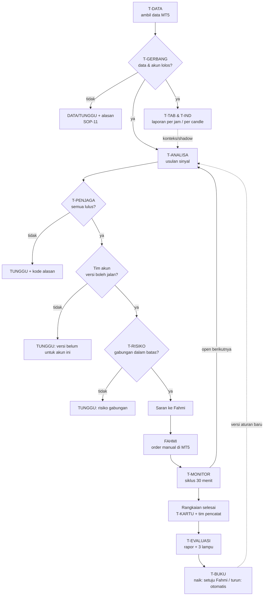
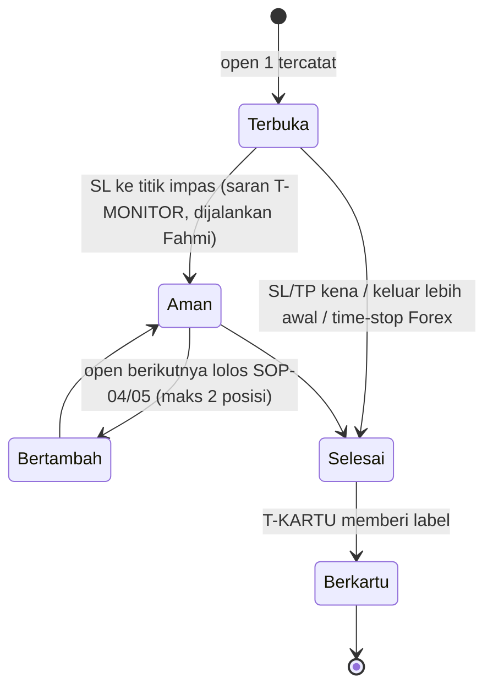
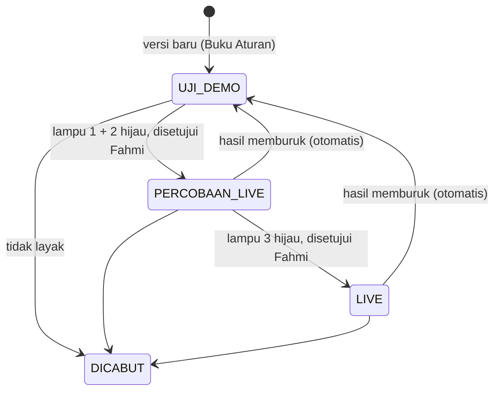

# SOP Tim MDBKA — Tugas, Tanggung Jawab, Kewenangan, dan Alur Kerja

13 Okt 2026 · Fahmi Alhabsi

> **Status:** DRAF, revisi 0. Belum ada kode yang diubah. Setiap SOP berlaku mulai saat komponen yang diaturnya selesai dibangun (kolom "Berlaku saat"). Sampai itu, SOP menjadi acuan pembangunan.
> **Terkait:** `docs/RANCANGAN-2026-10-13-alur-trader-profesional.md`, `docs/RANCANGAN-2026-10-13-fondasi-data-dan-jalur-live.md`, `docs/RANCANGAN-2026-10-13-tim-akun-tab-indikator.md`, `docs/AUDIT-RANCANGAN-2026-10-13.md`.
> **Format:** mengikuti unsur SOP Administrasi Pemerintahan yang lazim dipakai (rujukan Permenpan RB No. 35 Tahun 2012): identitas SOP dan tabel uraian prosedur dengan pelaksana dan mutu baku (persyaratan/kelengkapan, waktu, output), disesuaikan untuk aplikasi.

## A. Bedah ulang: siapa melakukan apa

### A1. Daftar tim

"Tim" adalah modul aturan murni di MDBKA (tanpa AI, tanpa orang), kecuali **Fahmi** (pemilik dan satu-satunya pelaksana order) dan **Pengembang** (Claude, yang membangun modul sesuai langkah yang disetujui).

| Kode | Tim | Lapis | Asal di rancangan |
| --- | --- | --- | --- |
| T-DATA | Tim Data: EA/service MT5 + penerima di server | 0 | Fondasi A |
| T-GERBANG | Tim Gerbang Data: kualitas data + identitas akun | 1 | Fondasi A1, A3 |
| T-TAB-TRADE | Tim Tab Trade | 2 | Tim tab, bagian 4 |
| T-TAB-EXPOSURE | Tim Tab Exposure | 2 | Tim tab, bagian 4 |
| T-TAB-CALENDAR | Tim Tab Calendar | 2 | Tim tab, bagian 4 |
| T-TAB-EXPERTS | Tim Tab Experts | 2 | Tim tab, bagian 4 |
| T-TAB-JOURNAL | Tim Tab Journal | 2 | Tim tab, bagian 4 |
| T-TAB-ALERTS | Tim Tab Alerts (peringatan buatan MDBKA) | 2 | Tim tab, bagian 4 |
| T-IND | Tim Indikator (Trend, Oscillators, Volume, Bill Williams); koordinatornya Tim 3 | 2 | Tim indikator, bagian 5 |
| T-ANALISA | Tim Analisa (Tim 1, pemindai `scanSymbol`) | 3 | Alur 7.8 |
| T-PENJAGA | Tim Penjaga Mode Aman (biaya, risiko, spesifikasi, bukti, jeda, berita, sesi, pembukaan bursa, korelasi, margin) | 4 | Audit, alur 3.7 |
| T-SHADOW | Tim Shadow (A7-2/A7-3, hanya mencatat) | 4 | Fondasi A8 |
| T-AKUN-DEMO | Tim Akun Demo (per login demo) | 5 | Tim akun, bagian 3 |
| T-AKUN-LIVE | Tim Akun Live (per login Live) | 5 | Tim akun, bagian 3 |
| FAHMI | Pemilik: menyetujui dan menempatkan order di MT5 | 6 | — |
| T-MONITOR | Tim Monitor Posisi (Tim 2, termasuk `exitMonitor`) | 7 | Alur 7 |
| T-RISIKO | Tim Risiko Gabungan | 7 | Fondasi E |
| T-TITIK-LEMAH | Tim 4: penguji titik lemah | 8 | Alur 7.8 |
| T-POLA | Tim 5: pembaca pola | 8 | Alur 7.8 |
| T-KONTEKS | Tim 6: pencatat konteks | 8 | Alur 7.8 |
| T-BERITA | Tim 6b: pencatat respons berita | 8 | Alur 7.8 |
| T-BIAYA | Tim 7: pencatat biaya | 8 | Alur 7.8 |
| T-KARTU | Tim 8: penggabung dan pemberi label kartu pola | 8 | Alur 7.8 |
| T-EVALUASI | Tim Evaluasi: rapor, 3 lampu hijau | 9 | Fondasi C |
| T-PERUBAHAN | Tim Pemantau Perubahan Kondisi | 9 | Fondasi F |
| T-BUKU | Tim Penjaga Buku Aturan | 9 | Fondasi C2 |
| PENGEMBANG | Claude: membangun dan memperbaiki modul | — | Aturan kerja |

### A2. Jenis kewenangan

| Kode | Kewenangan | Arti |
| --- | --- | --- |
| B | Baca | Membaca data atau catatan tim lain |
| C | Catat | Menulis ke catatannya sendiri saja (append-only) |
| H | Hitung | Mengolah data menjadi angka atau temuan |
| U | Usul | Mengusulkan sinyal, saran, atau perubahan |
| T | Tahan | Mengubah sinyal menjadi TUNGGU/DATA |
| S | Status | Mengubah status versi aturan di Buku Aturan |
| E | Eksekusi | Menempatkan, mengubah, atau menutup order di MT5 |
| P | Setujui | Menyetujui naik status, perubahan aturan, atau perubahan SOP |

### A3. Tugas, tanggung jawab, dan kewenangan per tim

| Tim | Tugas | Tanggung jawab (yang dijamin) | Kewenangan | Tidak berwenang |
| --- | --- | --- | --- | --- |
| T-DATA | Mengambil candle, kuotasi, posisi, equity, kalender, sesi, spesifikasi, History, log | Data tersimpan apa adanya, lengkap dengan jam asli dan jam diterima | B, C | Mengubah atau membuang data |
| T-GERBANG | Memeriksa kualitas data dan identitas akun (login, jenis akun) | Tidak ada data rusak, basi, atau akun tak jelas yang lolos diam-diam | B, H, C, **T** | Membuka sinyal |
| T-TAB-TRADE | Merangkum posisi, SL/TP, untung/rugi, margin | **Satu-satunya sumber data posisi** bagi tim lain | B, H, C, U | Menahan sinyal; menyentuh order |
| T-TAB-EXPOSURE | Menghitung eksposur per mata uang dan golongan dari data T-TAB-TRADE | Angka eksposur konsisten dengan posisi | B, H, C | Menahan sinyal (itu wewenang T-PENJAGA dan T-RISIKO) |
| T-TAB-CALENDAR | Merangkum berita dan Actual/Forecast | **Satu-satunya sumber data kalender** | B, H, C | Menahan sinyal (itu wewenang penjaga berita) |
| T-TAB-EXPERTS | Membaca log EA/service | Kejadian EA berhenti/error dilaporkan segera | B, H, C, U | Menahan sinyal langsung (melapor ke T-GERBANG) |
| T-TAB-JOURNAL | Membaca log terminal: koneksi, login, order manual dan penolakan | Kejadian koneksi/login/order ditolak dilaporkan segera | B, H, C, U | Sama dengan T-TAB-EXPERTS |
| T-TAB-ALERTS | Mencatat peringatan buatan MDBKA dan apakah ditindaklanjuti | Tidak ada peringatan yang hilang | B, C | Membuat peringatan baru sendiri |
| T-IND | Menghitung indikator dari candle tertutup sesuai kontrak data | **Satu perhitungan per indikator per candle**, dipakai bersama oleh semua tim (termasuk T-ANALISA) | B, H, C | Menambah skor atau mengubah keputusan |
| T-ANALISA | Menilai snapshot dan mengusulkan BELI/JUAL/TUNGGU dengan SL/TP/lot | Satu kontrak keputusan untuk semua jalur (fondasi A7) | B, H, C, **U** | Melewati penjaga; menahan sinyal di luar aturan strategi |
| T-PENJAGA | Menjalankan penjaga dengan urutan tetap | Setiap sinyal diperiksa semua penjaga; alasan tahanan jelas | B, H, C, **T** | Membuka atau melonggarkan sinyal |
| T-SHADOW | Menghitung "seharusnya" untuk Hasil analisa | Tidak pernah mengubah tampilan | B, H, C | Menahan atau mengubah apa pun yang tampil |
| T-AKUN-DEMO | Menyaring sinyal menurut versi aturan yang boleh jalan di demo; mencatat setara Live atau tidak | Eksperimen demo tidak bocor ke Live | B, C, **T** (menurut status versi) | Menulis ke catatan akun Live |
| T-AKUN-LIVE | Hanya meneruskan sinyal dari versi PERCOBAAN_LIVE/LIVE | Akun Live tidak menerima eksperimen | B, C, **T** | Menjalankan fitur uji |
| FAHMI | Memutuskan order dan menyetujui perubahan | Order di MT5; persetujuan tertulis | **E**, **P** | — |
| T-MONITOR | Saran tiap siklus 30 menit: titik impas, keluar lebih awal, open berikutnya, time-stop | Saran tepat waktu dan sesuai batas pengaman (alur 7.3) | B, H, C, U | Membuka posisi; menjauhkan SL; mengirim order |
| T-RISIKO | Menghitung risiko gabungan dan skenario stres | Rugi gabungan bila semua SL kena selalu terlihat | B, H, C, **T** (sinyal baru bila melewati batas) | Mengubah batas risiko |
| T-TITIK-LEMAH | Mencari sebab TP tidak tercapai / SL kena setelah rangkaian selesai | Setiap rangkaian rugi punya label sebab | B, H, C | Mengubah aturan |
| T-POLA | Mencatat pola selama posisi berjalan dan arah sesudahnya | Catatan pola dengan candle tertutup saja | B, H, C | Mengusulkan open |
| T-KONTEKS | Mencatat keadaan pasar saat entry | Konteks lengkap per entry | B, C | — |
| T-BERITA | Mencatat respons harga/spread terhadap berita | Respons berita tercatat dengan jam yang benar | B, H, C | Menahan sinyal |
| T-BIAYA | Mencatat spread, komisi, swap, selisih harga analisa vs entry | Biaya nyata per posisi | B, H, C | — |
| T-KARTU | Menggabungkan catatan menjadi satu kartu dan memberi label sesuai aturan | Satu kartu per rangkaian selesai, tidak pernah digabung | B, C | Menilai di luar aturan label |
| T-EVALUASI | Menyusun rapor, menilai 3 lampu hijau, mengusulkan naik status; menurunkan status otomatis bila syarat turun terpenuhi | Rapor per golongan, per versi, per jenis akun | B, H, C, U, **S** (turun saja) | Menaikkan status tanpa persetujuan Fahmi |
| T-PERUBAHAN | Memantau perubahan kondisi per versi aturan | Versi yang berubah besar ditandai "perlu ditinjau" | B, H, C, **S** (menghentikan kenaikan) | Menaikkan status |
| T-BUKU | Menyimpan Buku Aturan dan riwayat status | Setiap perubahan status tercatat dan di-commit | B, C, **S** (naik, setelah P Fahmi) | Mengubah aturan tanpa persetujuan |
| PENGEMBANG | Membangun modul sesuai langkah yang disetujui | Test lolos (`npm test`, `tsc -b`, lint), satu langkah kecil, tanpa auto-commit | B, U | Mengubah aturan, rumus `decisionEngine.ts`, atau status tanpa persetujuan; commit otomatis |

### A4. Pertentangan yang ditemukan dan penyelesaiannya

| # | Pertentangan | Penyelesaian |
| --- | --- | --- |
| 1 | T-TAB-TRADE, T-MONITOR, dan T-BIAYA sama-sama membaca posisi; bisa terjadi angka berbeda | T-TAB-TRADE satu-satunya pembaca posisi; tim lain memakai catatannya |
| 2 | T-TAB-EXPOSURE, T-RISIKO, dan penjaga korelasi sama-sama menilai eksposur | T-TAB-EXPOSURE menghitung; T-RISIKO menilai skenario; hanya T-PENJAGA (korelasi) dan T-RISIKO (batas gabungan) yang boleh menahan |
| 3 | T-TAB-CALENDAR, penjaga berita, dan T-BERITA sama-sama memakai kalender | T-TAB-CALENDAR satu-satunya sumber; penjaga berita yang menahan; T-BERITA hanya mencatat sesudah kejadian |
| 4 | T-IND dan T-ANALISA bisa menghitung MA50/RSI/CCI/MACD/ATR dua kali dengan hasil berbeda | Satu perhitungan per candle oleh fungsi yang sama (`indicators.ts`); nilai di kartu sama persis dengan yang dipakai keputusan |
| 5 | T-MONITOR menyarankan "open berikutnya", bisa dianggap jalan pintas melewati penjaga | Saran open = permintaan penilaian baru ke T-ANALISA; tetap lewat T-PENJAGA dan tim akun |
| 6 | T-TAB-EXPERTS/JOURNAL menemukan masalah dan ingin menahan sinyal | Mereka melapor; T-GERBANG yang memutuskan DATA/TUNGGU |
| 7 | T-AKUN-DEMO menjalankan fitur uji yang bisa memengaruhi jeda dan bukti Live | Catatan per login; Live hanya menghitung entri setara Live (K-4) |
| 8 | T-EVALUASI ingin menaikkan versi, T-PERUBAHAN menandai "perlu ditinjau" | Tanda T-PERUBAHAN menang: kenaikan berhenti sampai diuji ulang |
| 9 | Naik status dan turun status punya risiko berbeda | Turun otomatis (lebih aman); naik butuh bukti + persetujuan Fahmi |
| 10 | Dua tim melaporkan fakta berbeda (misalnya login di Journal ≠ label akun) | T-GERBANG menahan (TUNGGU) dan melapor ke Fahmi; tidak memilih salah satu diam-diam |
| 11 | T-TITIK-LEMAH menemukan sebab rugi dan "ingin" mengubah aturan | Sebab dicatat; perubahan aturan hanya lewat T-EVALUASI → Fahmi → T-BUKU, setelah sebab berulang n ≥ 20 |
| 12 | Laporan per jam vs kejadian penting | Kejadian penting dilaporkan segera; laporan per jam tetap berjalan |
| 13 | T-SHADOW dan Hasil analisa memakai data yang sama | T-SHADOW hanya membaca; tidak ada jalur balik ke tampilan |
| 14 | T-MONITOR (time-stop 3 jam) vs golongan tanpa time-stop | K-1: Forex/Forex JPY time-stop; emas, minyak, indeks hanya akhir masa pantau intensif |

### A5. Tujuh aturan wewenang

1. **Menahan boleh dari beberapa tim; membuka hanya satu jalur:** T-ANALISA → T-PENJAGA → tim akun → saran ke Fahmi.
2. **Satu fakta, satu pemilik:** posisi (T-TAB-TRADE), kalender (T-TAB-CALENDAR), indikator (T-IND), identitas akun (T-GERBANG).
3. **Setiap tim hanya menulis ke catatannya sendiri**; membaca catatan tim lain boleh.
4. **Naik status butuh bukti dan persetujuan Fahmi; turun status otomatis.**
5. **Fakta yang bertentangan berarti TUNGGU**, ditambah laporan ke Fahmi.
6. **Laporan tidak pernah langsung mengubah keputusan**; perubahan hanya lewat Buku Aturan.
7. **Demo dan Live terpisah**: catatan, jeda, bukti, dan status versi.

## B. Matriks kegiatan

**Pemilik** = bertanggung jawab atas hasil; **Pelaksana** = mengerjakan; **Diberi tahu** = menerima laporan; **Penyetuju** = harus setuju sebelum berlaku.

| Kegiatan | Pemilik | Pelaksana | Diberi tahu | Penyetuju |
| --- | --- | --- | --- | --- |
| Mengambil dan menyimpan data | T-DATA | T-DATA | T-GERBANG | — |
| Menahan karena data buruk / akun tak jelas | T-GERBANG | T-GERBANG | Semua tim, Fahmi | — |
| Laporan tab per jam | Masing-masing T-TAB | Masing-masing T-TAB | T-GERBANG, T-MONITOR, T-RISIKO | — |
| Menghitung indikator | T-IND | T-IND | T-ANALISA, T-KARTU | — |
| Mengusulkan sinyal | T-ANALISA | T-ANALISA | T-PENJAGA | — |
| Menahan sinyal (penjaga) | T-PENJAGA | T-PENJAGA | Tim akun, Fahmi | — |
| Menyaring sinyal per akun | Tim akun | Tim akun | Fahmi | — |
| Menempatkan order | FAHMI | FAHMI | T-TAB-TRADE | — |
| Saran posisi berjalan | T-MONITOR | T-MONITOR | Fahmi | — |
| Menahan karena risiko gabungan | T-RISIKO | T-RISIKO | Tim akun, Fahmi | — |
| Membuat kartu pola | T-KARTU | T-KARTU (dari catatan T-TITIK-LEMAH s.d. T-BIAYA) | T-EVALUASI | — |
| Menyusun rapor dan menilai lampu | T-EVALUASI | T-EVALUASI | Fahmi | — |
| Menaikkan status versi | T-BUKU | T-BUKU | Semua tim | **FAHMI** |
| Menurunkan status versi | T-EVALUASI | T-BUKU | Fahmi, semua tim | — (otomatis) |
| Menghentikan kenaikan (perubahan kondisi) | T-PERUBAHAN | T-PERUBAHAN | T-EVALUASI, Fahmi | — |
| Membangun/mengubah modul | PENGEMBANG | PENGEMBANG | Fahmi | **FAHMI** (commit oleh Fahmi) |
| Mengubah SOP | Fahmi | PENGEMBANG (menyusun draf) | Semua tim | **FAHMI** |

## C. SOP

### C0. Identitas bersama semua SOP

| Unsur | Isi |
| --- | --- |
| Tanggal pembuatan | 13 Okt 2026 |
| Tanggal revisi | — (revisi 0) |
| Tanggal efektif | Per SOP, saat komponen yang diatur selesai dibangun ("Berlaku saat") |
| Disahkan oleh | Fahmi Alhabsi — tanggal: ______ |
| Dasar | Aturan mutlak `HANDOVER-CLAUDE.md` bagian 5; prinsip rancangan alur (bagian 2); rancangan fondasi; rancangan tim; keputusan K-1 s.d. K-9 di `docs/AUDIT-RANCANGAN-2026-10-13.md` |
| Peralatan/perlengkapan | 4 terminal MT5 (Finex, OTB, MIFX, Exness) dengan EA `MDBKAMultiLive`, `ExportPositions` dan service `AutoExportMDBKAService`, `MDBKACalendarService`, `MDBKAHistoryService`; server Express MDBKA; aplikasi MDBKA; folder `Common\Files` dan `data/` |
| Pencatatan dan pendataan | Tabel JSONL append-only: `keputusan`, `rangkaian`, `kartu_pola`, `laporan_tim` (fondasi G dan rancangan tim bagian 7); Buku Aturan dan riwayat status di `config/` (ikut git) |
| Peringatan umum | MDBKA tidak pernah mengirim order. Rumus `decisionEngine.ts` dan parser tidak diubah. Data tidak ada → `null`, bukan angka karangan |

### SOP-MDBKA-01 — Pengambilan dan Validasi Data

| Unsur | Isi |
| --- | --- |
| Kualifikasi pelaksana | T-DATA, T-GERBANG |
| Keterkaitan | Prasyarat semua SOP lain |
| Peringatan | Data yang gagal diperiksa tidak boleh dipakai analisa; ketiadaan data ≠ tidak ada risiko |
| Berlaku saat | Sebagian sekarang (pengambilan data); penuh setelah F1–F4 dan F2/F3 |

| No | Uraian Prosedur | Pelaksana | Persyaratan/Kelengkapan | Waktu | Output | Keterangan |
| --- | --- | --- | --- | --- | --- | --- |
| 1 | Mengambil candle, kuotasi, posisi, equity, kalender, sesi, spesifikasi, History, dan log dari setiap terminal | T-DATA | EA/service aktif; satu broker satu instalasi MT5 | Terus-menerus | Berkas data per broker/login | Jam asli MT5 dan jam diterima disimpan |
| 2 | Mencocokkan login dan jenis akun dengan `ACCOUNT_LABELS` | T-GERBANG | Login dan `ACCOUNT_TRADE_MODE` dari EA (setelah F3) | Setiap data masuk | Status akun: demo / Live / tidak terbukti | Akun tanpa label = Live (K-3) |
| 3 | Memeriksa kualitas: candle hilang/dobel, kuotasi basi, jam tidak urut, spesifikasi lama, EA berhenti | T-GERBANG | Batas per golongan (fondasi A3) | Setiap data masuk | Daftar hasil pemeriksaan | — |
| 4 | Bila ada yang gagal: tetapkan DATA/TUNGGU untuk simbol/broker terkait dan tampilkan sebabnya | T-GERBANG | Hasil langkah 3 | Segera | Status DATA/TUNGGU + alasan di layar | Kejadian penting → SOP-11 |
| 5 | Meneruskan data yang lolos ke tim pengamat dan T-ANALISA | T-GERBANG | Lolos semua pemeriksaan | Segera | Snapshot data siap pakai | — |

### SOP-MDBKA-02 — Pengamatan Tab MT5 dan Laporan per Jam

| Unsur | Isi |
| --- | --- |
| Kualifikasi pelaksana | T-TAB-TRADE, T-TAB-EXPOSURE, T-TAB-CALENDAR, T-TAB-EXPERTS, T-TAB-JOURNAL, T-TAB-ALERTS |
| Keterkaitan | SOP-01 (masukan), SOP-06, SOP-09, SOP-11 (penerima) |
| Peringatan | News, Mailbox, Articles, dan alert manual tidak bisa dibaca program (tertunda D5–D8); tidak ada laporan karangan untuk tab itu |
| Berlaku saat | Trade, Exposure, Calendar: setelah TT-1/TT-2. Experts, Journal: setelah TT-3. Alerts: setelah TT-4 |

| No | Uraian Prosedur | Pelaksana | Persyaratan/Kelengkapan | Waktu | Output | Keterangan |
| --- | --- | --- | --- | --- | --- | --- |
| 1 | Membaca data tab dari snapshot yang lolos SOP-01 | Masing-masing T-TAB | Snapshot lolos gerbang | Terus-menerus | Data tab per login | Satu fakta, satu pemilik |
| 2 | Menganalisa sesuai tugas tab (rancangan tim bagian 4) | Masing-masing T-TAB | Data langkah 1 | Terus-menerus | Temuan | — |
| 3 | Bila menemukan kejadian penting (EA berhenti, koneksi putus, order ditolak, margin menipis, posisi tanpa SL): laporkan segera | T-TAB terkait | Temuan langkah 2 | Segera | Laporan kejadian penting | Lanjut ke SOP-11 |
| 4 | Menyusun laporan jendela 1 jam (jam server yang sama untuk semua tab) | Masing-masing T-TAB | Semua temuan dalam jendela | Setiap pergantian jam server | Baris `laporan_tim` | — |
| 5 | Menyerahkan laporan ke penerima sesuai matriks B | Masing-masing T-TAB | Laporan langkah 4 | Setiap jam | Laporan diterima | Laporan tidak mengubah keputusan langsung |

### SOP-MDBKA-03 — Perhitungan dan Pelaporan Indikator

| Unsur | Isi |
| --- | --- |
| Kualifikasi pelaksana | T-IND (koordinator: Tim 3) |
| Keterkaitan | SOP-01 (masukan), SOP-04 (indikator yang sudah dipakai), SOP-07 (kartu) |
| Peringatan | Candle belum tutup tidak dipakai; Fractal sah setelah 2 bar di kanan; indikator yang berkaitan bukan bukti terpisah; Forex/CFD = tick volume |
| Berlaku saat | Indikator yang sudah ada: sekarang. Gelombang 1: setelah TI-1 dan TI-2 |

| No | Uraian Prosedur | Pelaksana | Persyaratan/Kelengkapan | Waktu | Output | Keterangan |
| --- | --- | --- | --- | --- | --- | --- |
| 1 | Memeriksa simbol, broker, timeframe, dan bahwa candle sudah tertutup | T-IND | Snapshot lolos SOP-01 | Setiap candle tertutup | Konfirmasi siap hitung | — |
| 2 | Menghitung indikator dengan parameter versi yang berlaku (periode, metode, harga yang dipakai, jenis volume, shift) | T-IND | Kontrak data (rancangan tim 5.1); test pembanding MT5 lolos | Setiap candle tertutup | Nilai indikator + parameternya | Satu perhitungan dipakai bersama |
| 3 | Membagi nilai ke T-ANALISA (indikator yang sudah dipakai keputusan), catatan `keputusan` (konteks), dan T-KARTU | T-IND | Nilai langkah 2 | Segera | Nilai terbagi | Indikator baru hanya konteks/shadow |
| 4 | Melaporkan ringkasan per candle H1 tertutup | T-IND | — | Setiap jam | Baris `laporan_tim` | — |

### SOP-MDBKA-04 — Analisa Sinyal dan Penjaga

| Unsur | Isi |
| --- | --- |
| Kualifikasi pelaksana | T-ANALISA, T-PENJAGA, T-SHADOW |
| Keterkaitan | SOP-01, SOP-03 (masukan); SOP-05 (penerima); SOP-08 (shadow) |
| Peringatan | Rumus `decisionEngine.ts` tidak diubah; urutan penjaga tetap; Hasil analisa Finex tidak berubah (aturan mutlak 1) |
| Berlaku saat | Sekarang (pemindai dan penjaga sudah ada); kontrak tunggal setelah A7-4 s.d. A7-6 |

| No | Uraian Prosedur | Pelaksana | Persyaratan/Kelengkapan | Waktu | Output | Keterangan |
| --- | --- | --- | --- | --- | --- | --- |
| 1 | Membangun snapshot keputusan dari data yang lolos SOP-01 dan nilai T-IND | T-ANALISA | Snapshot lengkap (fondasi A7) | Setiap candle tertutup / permintaan | Snapshot + sidik jari | — |
| 2 | Menilai strategi aktif dan gerbang risiko (biaya ≤ 10%, risiko 1% dan batas golongan) | T-ANALISA | Versi strategi dari Buku Aturan | Segera | Usulan BELI/JUAL/TUNGGU + SL/TP/lot | — |
| 3 | Menjalankan penjaga berurutan: spesifikasi → bukti → jeda → berita → sesi → pembukaan → korelasi | T-PENJAGA | Usulan langkah 2 | Segera | Status akhir + kode alasan + daftar semua penjaga (lulus/gagal) | Penjaga pertama yang gagal menentukan status |
| 4 | Untuk Hasil analisa: menghitung "seharusnya" dengan penjaga sesi dan urutan pemindai | T-SHADOW | Hasil yang tampil | Saat Hasil analisa dibuka | Catatan shadow (bila berbeda) | Lihat SOP-08 |
| 5 | Mencatat keputusan | T-ANALISA | — | Saat status berubah / LOLOS / entry / diminta | Baris `keputusan` | — |
| 6 | Meneruskan ke tim akun | T-ANALISA | Status langkah 3 | Segera | Sinyal ke SOP-05 | — |

### SOP-MDBKA-05 — Penanganan Sinyal per Akun dan Saran ke Fahmi

| Unsur | Isi |
| --- | --- |
| Kualifikasi pelaksana | T-AKUN-DEMO, T-AKUN-LIVE, T-RISIKO, FAHMI |
| Keterkaitan | SOP-04 (masukan); SOP-06 (sesudah order) |
| Peringatan | Live hanya versi PERCOBAAN_LIVE/LIVE; Finex demo baru dilonggarkan setelah F3 (K-2); gerbang biaya tetap aktif di demo (K-9) |
| Berlaku saat | Penyaringan per akun: setelah saklar mode (fase 2) dan J1 |

| No | Uraian Prosedur | Pelaksana | Persyaratan/Kelengkapan | Waktu | Output | Keterangan |
| --- | --- | --- | --- | --- | --- | --- |
| 1 | Menentukan akun aktif dan jenisnya dari T-GERBANG | Tim akun | Status akun SOP-01 | Segera | Akun + jenis | Tidak terbukti demo = Live |
| 2 | Menyaring sinyal menurut status versi aturan yang boleh jalan di akun itu | T-AKUN-DEMO / T-AKUN-LIVE | Buku Aturan | Segera | Sinyal diteruskan / ditahan | Demo: semua versi; Live: PERCOBAAN_LIVE/LIVE |
| 3 | Memeriksa risiko gabungan bila sinyal diambil | T-RISIKO | Posisi dari T-TAB-TRADE | Segera | Lolos / TUNGGU (melewati batas) | — |
| 4 | Menandai "setara Live" atau daftar fitur yang dilonggarkan | Tim akun | Versi + penjaga yang aktif | Segera | Tanda di `keputusan` | Untuk bukti (K-4) |
| 5 | Menampilkan saran: arah, entry, SL, TP, lot, risiko dalam Rupiah, alasan | Tim akun | Sinyal lolos | Segera | Saran di layar | — |
| 6 | Memutuskan dan menempatkan order di MT5 (bila setuju) | FAHMI | Saran langkah 5 | Sesuai keputusan Fahmi | Order di MT5 | MDBKA tidak mengirim order |
| 7 | Mencatat entry baru begitu posisi terlihat | T-TAB-TRADE | Posisi baru | Segera | Baris `entries` + awal `rangkaian` | Lanjut ke SOP-06 |

### SOP-MDBKA-06 — Pemantauan Posisi dan Rangkaian (Tim 2)

| Unsur | Isi |
| --- | --- |
| Kualifikasi pelaksana | T-MONITOR, T-TAB-TRADE, T-ANALISA, T-PENJAGA, FAHMI |
| Keterkaitan | SOP-05 (masukan); SOP-07 (sesudah rangkaian selesai) |
| Peringatan | SL hanya digeser ke arah untung; TP diperpanjang hanya setelah SL ≥ titik impas; arah berlawanan hanya setelah posisi lama ditutup; maksimal 2 posisi per simbol (K-7) |
| Berlaku saat | Saran titik impas dan time-stop: sekarang (`exitMonitor`). Siklus 30 menit penuh: setelah F5/T1 |

| No | Uraian Prosedur | Pelaksana | Persyaratan/Kelengkapan | Waktu | Output | Keterangan |
| --- | --- | --- | --- | --- | --- | --- |
| 1 | Membuka rangkaian saat open 1 tercatat | T-MONITOR | Entry dari SOP-05 | Segera | `rangkaian` baru | — |
| 2 | Menilai posisi di menit 20–30 setiap siklus 30 menit | T-MONITOR | Data dari T-TAB-TRADE + candle tertutup | Setiap 30 menit | Saran: tahan / titik impas / keluar lebih awal / ajukan open berikutnya | Alur 7.7 |
| 3 | Bila saran "open berikutnya": mengajukan permintaan penilaian ke T-ANALISA | T-MONITOR | Semua posisi rangkaian sudah aman; posisi < 2 | Segera | Permintaan penilaian | Tetap lewat SOP-04 dan SOP-05 |
| 4 | Fahmi menjalankan atau tidak menjalankan saran di MT5 | FAHMI | Saran | Sesuai keputusan | Perubahan order (bila ada) | Tindakan tercatat lewat T-TAB-TRADE |
| 5 | Di jam ke-3: Forex/Forex JPY → aba-aba tutup (time-stop); emas, minyak, indeks → masa pantau intensif selesai | T-MONITOR | Jam server sejak open 1 | Jam ke-3 | Aba-aba / status pantau | K-1 |
| 6 | Menutup rangkaian saat semua posisinya tertutup | T-MONITOR | Semua posisi tertutup (History) | Segera | `rangkaian` selesai | Lanjut ke SOP-07 |

### SOP-MDBKA-07 — Penutupan Rangkaian, Kartu Pola, dan Label

| Unsur | Isi |
| --- | --- |
| Kualifikasi pelaksana | T-TITIK-LEMAH, T-POLA, T-KONTEKS, T-BERITA, T-BIAYA, T-IND, T-KARTU |
| Keterkaitan | SOP-06 (masukan); SOP-10 (penerima) |
| Peringatan | Kartu hanya dari rangkaian selesai; tidak pernah digabung/ditimpa; data tidak lengkap ditandai, bukan dikarang |
| Berlaku saat | Setelah K1–K4 dan G-5 |

| No | Uraian Prosedur | Pelaksana | Persyaratan/Kelengkapan | Waktu | Output | Keterangan |
| --- | --- | --- | --- | --- | --- | --- |
| 1 | Menghitung hasil rangkaian dalam R, USD, Rupiah | T-BIAYA | History + biaya; R = total bersih ÷ risiko uang open 1 (K-5) | Saat rangkaian selesai | Hasil rangkaian | — |
| 2 | Mengisi catatan: indikator, konteks, berita, biaya, pola | T-IND, T-KONTEKS, T-BERITA, T-BIAYA, T-POLA | Catatan selama rangkaian | Saat rangkaian selesai | Catatan per tim | — |
| 3 | Mencari sebab bila TP tidak tercapai / SL kena | T-TITIK-LEMAH | Data MFE/MAE | Saat rangkaian selesai | Label sebab | — |
| 4 | Menggabungkan semua catatan dan memberi label: Kasbi Bakar / Popeda Sagu / Sagu Tumang / Pupare Rebus | T-KARTU | Hasil langkah 1–3 | Saat rangkaian selesai | `kartu_pola` bernomor | Label dari aturan, bukan penilaian |
| 5 | Menyusun sidik jari bertingkat (K-6) | T-KARTU | Kartu langkah 4 | Saat rangkaian selesai | Sidik jari tingkat 1–3 | — |
| 6 | Menyerahkan kartu ke T-EVALUASI | T-KARTU | — | Segera | Kartu diterima | — |

### SOP-MDBKA-08 — Uji Shadow

| Unsur | Isi |
| --- | --- |
| Kualifikasi pelaksana | T-SHADOW |
| Keterkaitan | SOP-04 (masukan); SOP-10 (evaluasi) |
| Peringatan | Tidak ada perubahan tampilan atau keputusan; error shadow tidak boleh memengaruhi Hasil analisa; berlaku untuk semua broker |
| Berlaku saat | Setelah S1–S3 |

| No | Uraian Prosedur | Pelaksana | Persyaratan/Kelengkapan | Waktu | Output | Keterangan |
| --- | --- | --- | --- | --- | --- | --- |
| 1 | Membaca hasil yang tampil dan data sesi/jam yang sama | T-SHADOW | Hasil analisa | Saat Hasil analisa dihitung | Masukan shadow | Hanya membaca |
| 2 | Menghitung keputusan "seharusnya" | T-SHADOW | — | Segera | Keputusan shadow | Dibungkus `try/catch` |
| 3 | Bila berbeda: mencatat lewat server (maksimal sekali per simbol per candle H1) | T-SHADOW | Perbedaan | Segera | `keputusan` dengan `jalur: hasil-shadow` | — |
| 4 | Menggabungkan dengan entri `DITAHAN_SESI` yang sudah tercatat untuk evaluasi | T-EVALUASI | Catatan shadow + `entries` | Berkala | Bukti per golongan | Bukti untuk draf klausul A9 |

### SOP-MDBKA-09 — Risiko Gabungan dan Pemantauan Perubahan Kondisi

| Unsur | Isi |
| --- | --- |
| Kualifikasi pelaksana | T-RISIKO, T-PERUBAHAN |
| Keterkaitan | SOP-02 (masukan), SOP-05 (menahan), SOP-10 (menghentikan kenaikan) |
| Peringatan | Tidak mengubah batas risiko; skenario dari data nyata, bukan karangan |
| Berlaku saat | T-RISIKO: setelah E1–E2 (sebelum fitur "masuk lagi"). T-PERUBAHAN: setelah P-F1–P-F2 |

| No | Uraian Prosedur | Pelaksana | Persyaratan/Kelengkapan | Waktu | Output | Keterangan |
| --- | --- | --- | --- | --- | --- | --- |
| 1 | Menghitung eksposur gabungan dan rugi bila semua SL kena (USD, Rupiah, % equity) | T-RISIKO | Data T-TAB-TRADE dan T-TAB-EXPOSURE | Setiap perubahan posisi | Panel risiko gabungan | — |
| 2 | Menahan sinyal baru bila rugi gabungan melewati batas | T-RISIKO | Batas dari Buku Aturan | Segera | TUNGGU + alasan | — |
| 3 | Menjalankan skenario stres (spread melebar, gap) | T-RISIKO | Arsip tick dan History | Harian | Laporan skenario | — |
| 4 | Merangkum frekuensi sinyal, tingkat TUNGGU, alasan tahanan, biaya per versi aturan | T-PERUBAHAN | Catatan `keputusan` | Harian | Ringkasan harian | — |
| 5 | Bila berubah besar dari patokan: tandai "perlu ditinjau" dan hentikan kenaikan status | T-PERUBAHAN | Patokan versi | Segera setelah terdeteksi | Tanda di Buku Aturan | Tanda ini menang atas kenaikan |

### SOP-MDBKA-10 — Evaluasi, Buku Aturan, dan 3 Lampu Hijau

| Unsur | Isi |
| --- | --- |
| Kualifikasi pelaksana | T-EVALUASI, T-BUKU, FAHMI |
| Keterkaitan | SOP-07, SOP-08, SOP-09 (masukan); SOP-04, SOP-05 (penerima versi baru) |
| Peringatan | n ≥ 20 hanya syarat minimum; semua kandidat yang diuji dicatat; tidak ada penyetelan otomatis; aturan tidak diubah setelah satu kali rugi |
| Berlaku saat | Setelah J1–J4 |

| No | Uraian Prosedur | Pelaksana | Persyaratan/Kelengkapan | Waktu | Output | Keterangan |
| --- | --- | --- | --- | --- | --- | --- |
| 1 | Menyusun rapor per golongan, per versi aturan, per jenis akun | T-EVALUASI | Kartu, `keputusan`, History, rapor backtest | Mingguan | Rapor | Isi rapor: alur bagian 4 |
| 2 | Menilai lampu 1 (backtest, dengan equity akun Live, tidak MODAL KURANG), lampu 2 (≥ 20 rangkaian demo setara Live, biaya Live), lampu 3 (20 rangkaian Live lot minimum) | T-EVALUASI | Rapor langkah 1 | Mingguan | Status lampu | Fondasi C5, K-8 |
| 3 | Mengusulkan naik status bila lampu terpenuhi dan tidak ada tanda "perlu ditinjau" | T-EVALUASI | Langkah 2 + SOP-09 | Saat terpenuhi | Usulan naik | — |
| 4 | Menyetujui atau menolak usulan naik | FAHMI | Usulan + rapor | Sesuai keputusan Fahmi | Persetujuan tertulis | — |
| 5 | Mencatat perubahan status dan commit | T-BUKU (dibuatkan PENGEMBANG, di-commit Fahmi) | Persetujuan langkah 4 | Setelah disetujui | `riwayat_status` + commit | — |
| 6 | Menurunkan status otomatis bila 20 rangkaian Live terakhir rata-rata ≤ 0 atau rugi beruntun melewati batas | T-EVALUASI → T-BUKU | Data Live | Segera setelah terpenuhi | Status turun ke UJI_DEMO + pemberitahuan | Tanpa menunggu persetujuan |
| 7 | Meninjau batas golongan Rupiah setiap naik tangga modal | T-EVALUASI, FAHMI | Rapor + modal akun | Setiap naik tangga | Usulan batas baru di Buku Aturan | Rancangan tim bagian 8 |

### SOP-MDBKA-11 — Penanganan Kejadian Penting

| Unsur | Isi |
| --- | --- |
| Kualifikasi pelaksana | T-TAB-EXPERTS, T-TAB-JOURNAL, T-TAB-TRADE, T-GERBANG, FAHMI |
| Keterkaitan | SOP-01, SOP-02 |
| Peringatan | Tidak menunggu laporan per jam; tidak membuka posisi atau mengirim order |
| Berlaku saat | Setelah TT-3 dan F2 |

| No | Uraian Prosedur | Pelaksana | Persyaratan/Kelengkapan | Waktu | Output | Keterangan |
| --- | --- | --- | --- | --- | --- | --- |
| 1 | Mendeteksi kejadian: EA/service berhenti, koneksi putus, order ditolak, login tidak sesuai label, margin menipis, posisi tanpa SL | T-TAB terkait | Log/data | Segera | Laporan kejadian | — |
| 2 | Menetapkan DATA/TUNGGU untuk broker/simbol terkait | T-GERBANG | Laporan langkah 1 | Segera | Status di layar | — |
| 3 | Memberi tahu Fahmi dengan sebab dan tindakan yang disarankan | T-GERBANG | — | Segera | Pemberitahuan | Contoh saran: periksa terminal, pasang SL |
| 4 | Fahmi menangani di MT5 bila perlu | FAHMI | Pemberitahuan | Sesuai keputusan Fahmi | Kejadian ditangani | — |
| 5 | Mencabut status DATA/TUNGGU setelah data kembali lolos pemeriksaan | T-GERBANG | Lolos SOP-01 | Segera | Status normal | Tercatat di `laporan_tim` |

### SOP-MDBKA-12 — Pengelolaan Perubahan Kode, Aturan, dan Dokumen

| Unsur | Isi |
| --- | --- |
| Kualifikasi pelaksana | PENGEMBANG, FAHMI |
| Keterkaitan | Semua SOP |
| Peringatan | Satu langkah kecil per giliran; test lama hanya ditambah; tanpa auto-commit; rumus `decisionEngine.ts` dan parser tidak diubah; file ber-CRLF/BOM dijaga formatnya |
| Berlaku saat | Sekarang |

| No | Uraian Prosedur | Pelaksana | Persyaratan/Kelengkapan | Waktu | Output | Keterangan |
| --- | --- | --- | --- | --- | --- | --- |
| 1 | Analisa akar masalah sebelum menulis kode | PENGEMBANG | Langkah yang disetujui di rancangan | Sebelum mulai | Analisa | — |
| 2 | Mengerjakan satu langkah kecil | PENGEMBANG | Analisa langkah 1 | Satu giliran | Perubahan kode/dokumen | — |
| 3 | Menjalankan `npm test`, `tsc -b`, dan lint | PENGEMBANG | Perubahan langkah 2 | Setelah perubahan | Hasil test | Nomor test berikutnya bertambah |
| 4 | Menjelaskan dengan bahasa awam: analogi, contoh data asli, kegunaan, batasan data, perubahan di layar, lalu catatan teknis | PENGEMBANG | Test lolos | Setelah test | Penjelasan | — |
| 5 | Memberi perintah commit terpisah per baris (`npm test; npm run build`, lalu `git add -A; git commit -m "..."; git push`) | PENGEMBANG | — | Setelah penjelasan | Perintah | — |
| 6 | Meninjau dan menjalankan commit | FAHMI | Penjelasan + hasil test | Sesuai keputusan Fahmi | Commit | — |
| 7 | Mengubah SOP: draf revisi → persetujuan Fahmi → nomor revisi naik → commit | PENGEMBANG, FAHMI | Alasan perubahan | Bila perlu | SOP revisi baru | — |

### SOP-MDBKA-13 — Cadangan dan Retensi Data

| Unsur | Isi |
| --- | --- |
| Kualifikasi pelaksana | T-DATA, FAHMI |
| Keterkaitan | Semua SOP yang menulis ke `data/` |
| Peringatan | `data/` tidak ikut git; satu-satunya pengaman adalah tombol Backup |
| Berlaku saat | Sekarang (tombol Backup sudah ada); folder baru setelah G-6 |

| No | Uraian Prosedur | Pelaksana | Persyaratan/Kelengkapan | Waktu | Output | Keterangan |
| --- | --- | --- | --- | --- | --- | --- |
| 1 | Menjalankan "Backup sekarang" | FAHMI | Server berjalan | Usulan: setiap hari | Salinan cadangan | — |
| 2 | Memastikan folder `keputusan`, `rangkaian`, `kartu`, `laporan` ikut dicadangkan | T-DATA | G-6 selesai | Setiap backup | Daftar folder tercadang | — |
| 3 | Menerapkan retensi: arsip tick dan `keputusan` non-LOLOS 120 hari; `keputusan` LOLOS/entry, `rangkaian`, `kartu_pola` selamanya | T-DATA | Fondasi G4 | Harian | Berkas lama dihapus sesuai aturan | Tidak menghapus yang selamanya |

## D. Alur, proses, dan workflow

### D1. Alur kerja induk

Satu-satunya jalan untuk membuka sinyal adalah garis tegas dari T-ANALISA sampai Fahmi. Semua cabang "tidak" berakhir di TUNGGU. Hasil evaluasi kembali ke T-ANALISA hanya sebagai versi aturan baru.

### D2. Siklus hidup rangkaian

### D3. Siklus hidup versi aturan

Tanda "perlu ditinjau" dari T-PERUBAHAN menghentikan semua panah naik sampai versi diuji ulang.

### D4. Serah terima antar tim

| Dari | Ke | Isi | Kapan | SOP |
| --- | --- | --- | --- | --- |
| T-DATA | T-GERBANG | Data mentah | Terus-menerus | 01 |
| T-GERBANG | T-TAB, T-IND, T-ANALISA | Snapshot lolos | Segera | 01 |
| T-TAB-* | T-GERBANG | Kejadian penting | Segera | 02, 11 |
| T-TAB-* | Penerima di matriks B | Laporan per jam | Setiap jam | 02 |
| T-IND | T-ANALISA, T-KARTU | Nilai indikator | Setiap candle tertutup | 03 |
| T-ANALISA | T-PENJAGA | Usulan sinyal | Segera | 04 |
| T-PENJAGA | Tim akun | Status + alasan | Segera | 04 |
| Tim akun | T-RISIKO, Fahmi | Sinyal tersaring, saran | Segera | 05 |
| FAHMI | T-TAB-TRADE | Order di MT5 (terlihat sebagai posisi) | Sesuai keputusan | 05 |
| T-TAB-TRADE | T-MONITOR | Posisi | Terus-menerus | 06 |
| T-MONITOR | T-ANALISA | Permintaan penilaian open berikutnya | Siklus 30 menit | 06 |
| T-MONITOR | Tim pencatat | Rangkaian selesai | Segera | 06, 07 |
| T-KARTU | T-EVALUASI | Kartu pola | Segera | 07 |
| T-SHADOW | T-EVALUASI | Catatan shadow | Berkala | 08 |
| T-PERUBAHAN | T-EVALUASI, T-BUKU | Tanda "perlu ditinjau" | Segera | 09 |
| T-EVALUASI | FAHMI | Usulan naik status | Saat lampu terpenuhi | 10 |
| T-BUKU | T-ANALISA, tim akun | Versi aturan baru/turun | Setelah dicatat | 10 |

## E. Mengelola dan mengevaluasi SOP

### E1. Ukuran kinerja tim

| Tim | Ukuran | Sumber |
| --- | --- | --- |
| T-GERBANG | Jumlah data rusak yang lolos (harus 0); waktu dari kejadian sampai status DATA/TUNGGU | `laporan_tim`, `keputusan` |
| T-TAB-* | Laporan per jam tidak ada yang terlewat; kejadian penting dilaporkan segera | `laporan_tim` |
| T-IND | Test pembanding MT5 lolos; tidak ada nilai dari candle belum tutup | Test, `keputusan` |
| T-ANALISA + T-PENJAGA | Test kembar lolos (pemindai = Hasil analisa); kode alasan lengkap | Test, `keputusan` |
| Tim akun | Tidak ada versi UJI_DEMO di akun Live; tanda setara Live lengkap | `keputusan` |
| T-MONITOR | Saran tiap siklus tepat waktu; tidak ada saran menjauhkan SL | `rangkaian` |
| T-RISIKO | Rugi gabungan selalu dalam batas Buku Aturan | Panel risiko |
| T-KARTU | Satu kartu per rangkaian selesai; label sesuai aturan | `kartu_pola` |
| T-EVALUASI | Rapor mingguan terbit; penurunan status otomatis berjalan | Rapor, `riwayat_status` |

### E2. Jadwal evaluasi

| Waktu | Kegiatan | Pelaksana |
| --- | --- | --- |
| Harian | Ringkasan otomatis: kejadian penting, laporan yang terlewat, ringkasan T-PERUBAHAN, skenario stres | Tim terkait |
| Mingguan | Rapor dan status 3 lampu; tinjauan Fahmi | T-EVALUASI, FAHMI |
| Bulanan | Tinjauan SOP: apakah ada pertentangan baru, tim yang tidak terpakai, atau ukuran yang selalu gagal | FAHMI, PENGEMBANG |
| Setiap naik tangga modal | Tinjauan batas golongan Rupiah dan kapasitas (lot maksimum, slippage) | T-EVALUASI, FAHMI |

### E3. Revisi SOP

1. Pengembang menyusun draf revisi beserta alasan dan dampaknya.
2. Fahmi menyetujui atau menolak.
3. Nomor revisi naik (revisi 0 → 1), tanggal revisi diisi.
4. Perubahan di-commit oleh Fahmi.

SOP yang bertentangan dengan aturan mutlak atau prinsip rancangan tidak boleh disahkan sebelum aturan itu sendiri diubah dengan persetujuan eksplisit.
